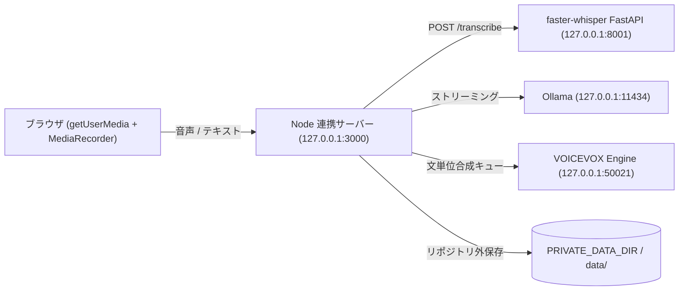

[English](README.md) | [繁體中文](README.zh-TW.md) | [日本語](README.ja.md)

# interview-dojo

**完全ローカル・API費用ゼロ（$0）** で動作する、**ITエンジニア／テックリード／PM（中途採用）向け** の日本語ビデオ模擬面接トレーニングツールです。

すべてのサービスは `127.0.0.1` 上でのみ動作し、カメラ映像・音声・職務経歴情報（`persona.yaml`）・文字起こし・評価レポートが外部へ送信されることはありません。


---

## 主な機能

- **プッシュ・トゥ・トーク音声対話：** ボタンまたは `Space` キーを押しながら話す → `faster-whisper`（`large-v3-turbo`, CUDA）が日英混じりの技術用語を文字起こし → Ollama（`gemma4:e4b`）が深掘り質問を生成 → `VOICEVOX` が文単位で音声合成・再生。
- **ローカル・バーチャル面接官（3方式切替＆設定記憶）：**
  - **方式1（SVG）：** 軽量な 2D キャラクター（スーツ姿の柴犬部長／デフォルメ面接官）と Web Audio リップシンク。
  - **方式2（3D / VRM）：** Three.js + `@pixiv/three-vrm` による 3D 面接官（ビジネスシャツ男性／スーツ柴犬）とカスタム `.vrm` 読込対応。ステートマシン（待機／傾聴／思考／発話）連動。
  - **方式3（Rive）：** ローカル版 `@rive-app/canvas` によるステートマシン・キャラクター（内蔵アバター／テディベア／独自 `.riv` ファイル対応）。
  - 選択した描画方式とキャラクターは `localStorage` に自動保存されます。
- **リアルタイム思考進捗＆音声リプレイ：** 3段階の進捗バー（`音声認識 → AI生成（文字数表示） → 音声合成`）と経過タイマーを表示。字幕バーおよび会話ログ各行の `🔊` ボタンで直前の発話をいつでも再生できます。
- **面接官の声質・話速カスタマイズ：** 落ち着いた男性声（青山龍星、玄野武宏など）やアナウンサー風女性声（No.7、九州そらなど）を選択でき、話速（`0.85x–1.35x`）も調整可能です。
- **全編録画＆タイムスタンプ連動再生：** 面接中の映像・音声（`.webm`）をローカル保存。終了後は文字起こし内の時刻（例：`[00:12]`）をクリックするだけで該当シーンへジャンプ再生できます。
- **8 GB VRAM 対応の振り返り評価＆話し方コーチング（`gemma4:12b`）：**
  - 面接終了時に会話用モデルと STT をアンロードしてから `gemma4:12b` を読み込むため、8 GB VRAM 環境でも安定動作します。
  - **結論ファースト**・**技術選定のトレードオフ**・**PM／ステークホルダー調整**・**ビジネス敬語の自然さ** の4観点で採点。
  - 回答回数、文字数、フィラー（「えー」「えっと」「あの」など）の出現回数を自動集計。
  - **「話し方の不明瞭点診断＆自然な敬語リライト」** セクションで、そのまま音読練習できる改善例を提示します。
- **HTML レポート一括エクスポート：** 指標・AI 講評・時刻付き文字起こしを1つのオフライン HTML ファイルとして保存できます（印刷による PDF 化にも対応）。

---

## システム構成と 8 GB VRAM 運用



---

## クイックスタート

### 1. 依存関係のインストールとモデル取得

```bash
git clone https://github.com/YozoraRoy/interview-dojo.git
cd interview-dojo
pnpm install

ollama pull gemma4:e4b
ollama pull gemma4:12b
```

### 2. ローカル STT サービス構築

```bash
cd services/stt
python -m venv .venv
.\.venv\Scripts\python -m pip install -r requirements.txt
cd ../..
```

### 3. 個人データの分離設定

**職務経歴書や録画データ、`.env` を Git リポジトリ内に置かないでください。**

```bash
cp .env.example .env
```

`.env` の `PRIVATE_DATA_DIR` にリポジトリ外のフォルダを指定し、必要に応じて `examples/persona.sample.yaml` を参考に `persona.yaml` を配置してください。

### 4. 起動（Windows）

```powershell
powershell -ExecutionPolicy Bypass -File scripts/start-all.ps1
```

ブラウザで **[http://127.0.0.1:3000](http://127.0.0.1:3000)** を開き、面接官の声を選んで練習を開始できます。

---

## ライセンスとクレジット表記

- **コードライセンス：** [MIT License](LICENSE)
- **VOICEVOX クレジット：** 音声合成には [VOICEVOX Engine](https://github.com/VOICEVOX/voicevox_engine) を使用しています。利用規約に基づきキャラクター名のクレジット表記（例：`VOICEVOX:青山龍星`、`VOICEVOX:ずんだもん`）が必要です。画面フッターに選択中キャラクターのクレジットが自動表示されます。
- **各種モデル：** 各モデルの利用規約（`Gemma` Terms of Use、`Whisper` MIT）に従います。
