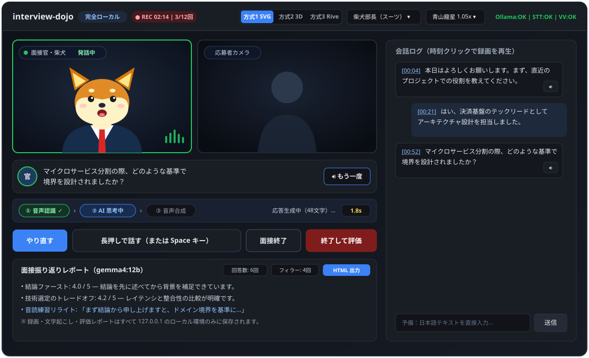

[English](README.md) | [繁體中文](README.zh-TW.md) | [日本語](README.ja.md)

# interview-dojo

**シニアソフトウェアエンジニア・テックリード・EM / PM** 向けの **ローカル優先・ハイブリッド LLM 対応** 日本語模擬面接スタジオ（**Next.js 16.4+ App Router + Cache Components** 製）。

すべてのサービスは `127.0.0.1` にバインドされ、カメラ録画・音声・職務経歴（`persona.yaml`）・BYOK API キーはローカル環境に保持されます。デフォルトでは Ollama による **完全ローカル・$0 運用** で動作し、必要に応じて外部 LLM API キーを設定して要約や振り返りレポートをクラウドモデルへルーティングすることも可能です。



---

## 主な機能

- **Next.js 16.4+ App Router & Cache Components：**
  - `/`：模擬面接メインステージ（Partial Prerendering 静的シェル + `<Suspense>` ストリーミング）。
  - `/sessions` & `/sessions/[id]`：過去の面接履歴、`206 Partial Content` HTTP `Range` による動画タイムライン再生・振り返り表示。
  - `/settings`：音声設定および BYOK 外部 LLM API キー管理・接続テスト（`POST /api/llm/test`）。
- **ハイブリッド LLM ルーティング（BYOK & コスト制御）：**
  - **Ollama**・**Google Gemini**・**OpenRouter**・**OpenAI**・**Groq**・**DeepSeek** に標準 `fetch` で対応。
  - リアルタイム会話はローカル Ollama（または Cloud Tier 1）、職務経歴要約（`Tier 2`）と事後評価（`Tier 3`）はクラウドを優先して 8 GB VRAM アンロード待機を回避。オフライン時や日次予算（`DAILY_BUDGET_USD`）超過時は自動でローカル Ollama へフォールバックします。
- **音声対話＆アバター（SVG / 3D VRM / Rive）：** `faster-whisper` + `VOICEVOX` による低遅延音声合成と Web Audio リップシンク。

---

## クイックスタート

```bash
git clone https://github.com/YozoraRoy/interview-dojo.git
cd interview-dojo
pnpm install
cp .env.example .env

# ローカル AI（Ollama + STT + VOICEVOX）と Next.js を一括起動
pnpm start:all
# 開発モード：pnpm dev:all
```

テストおよびビルド検証：

```bash
pnpm test
npx tsc --noEmit
pnpm build
```

---

## 📄 ライセンス（License）

本プロジェクトは **Sustainable Use License 1.0 (SUL)**（n8n と同様の fair-code / source-available ライセンス）の下で公開されています：

- ✅ **個人利用・研究・非商用利用**：無償で利用可能です。ソースコードは学習および個人利用のために GitHub 上で公開されています。
- ❌ **商用利用の制限**：許可なく本プロジェクトまたはその派生物を有料商用サービスとしてデプロイしたり、第三者に再販したりすることは禁止されています。
- 🔒 **商用ライセンス**：商用利用をご希望の場合は、GitHub Issue を作成するか [service@vestential.com](mailto:service@vestential.com) までご連絡ください。

詳細は [LICENSE](LICENSE) をご確認ください。
