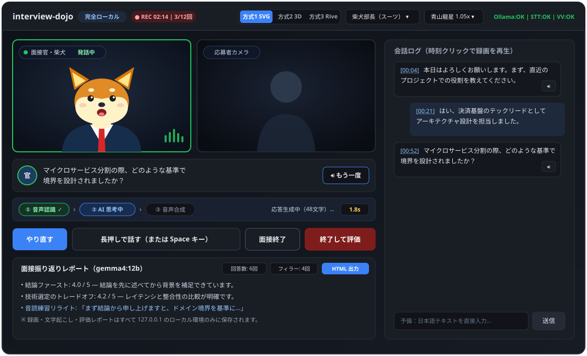
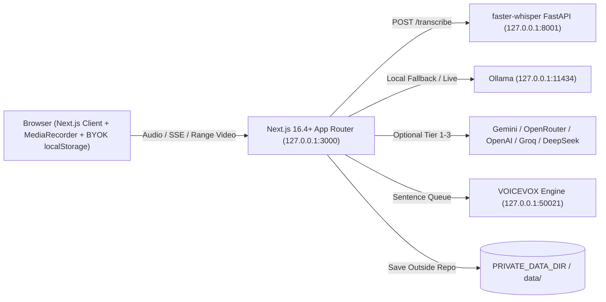

[English](README.md) | [繁體中文](README.zh-TW.md) | [日本語](README.ja.md)

# interview-dojo

A **local-first, hybrid-LLM** AI video mock-interview practice studio built with **Next.js 16.4+ (App Router + Cache Components)** for **mid-career software engineers, tech leads, and engineering managers / PMs** (focused on **Japanese** business & technical interviews).

Everything binds exclusively to `127.0.0.1` — your camera recording, microphone audio, resume (`persona.yaml`), transcripts, and BYOK API keys stay on your own machine. It runs **100% locally at $0** with Ollama by default, or optionally routes heavy tasks (resume summarization & post-interview review) to external cloud LLM APIs with automatic local fallback.



---

## Key Features

- **Next.js 16.4+ App Router & Cache Components:**
  - `/` — Live mock-interview stage with Partial Prerendering static shell + `<Suspense>` streaming.
  - `/sessions` & `/sessions/[id]` — Session history browser with `206 Partial Content` HTTP `Range` video playback and timestamp jump-to-seek.
  - `/settings` — Voice presets and BYOK external LLM API key management with live connection testing (`POST /api/llm/test`).
- **Hybrid Local + Cloud LLM Routing (BYOK & Cost Control):**
  - Supports **Ollama** (local default), **Google Gemini**, **OpenRouter**, **OpenAI**, **Groq**, and **DeepSeek** via zero-dependency native `fetch` providers.
  - **Smart Split:** Live turns default to local Ollama (or optional Cloud Tier 1); resume summarization (`Tier 2`) and post-interview review (`Tier 3`) prioritize cloud models to skip 8 GB VRAM unloading, automatically falling back to local Ollama when offline or over `DAILY_BUDGET_USD` (`data/usage-ledger.json`).
  - **BYOK Privacy:** User-entered API keys stay in browser `localStorage` and are forwarded per-request via headers without ever being written to disk.
- **Push-to-Talk Voice Loop (Low Latency):** Hold button / `Space` to speak → `faster-whisper` (`large-v3-turbo`, CUDA) transcribes Japanese/English mixed tech terms → streaming LLM response → `VOICEVOX` synthesizes sentence-by-sentence WAV audio.
- **Virtual Interviewer Avatars (3 Switchable Engines via `next/dynamic`):**
  - **SVG:** Lightweight 2D characters (*Suit Shiba Inu*, *Chibi Interviewer*) with Web Audio API lip-sync and auto-blinking.
  - **3D / VRM:** Three.js + `@pixiv/three-vrm` (`30 FPS` throttled, `low-power`) with procedural characters and custom `.vrm` upload.
  - **Rive:** `@rive-app/canvas` state-machine characters (`avatar-pack.riv`, `teddy.riv`, or custom `.riv` files).
- **Post-Interview Review & HTML Export:** Scores 4 mid-career dimensions, computes Japanese filler metrics (`えー / えっと / あの`), generates read-aloud Keigo rewrites, and exports a self-contained offline HTML report.

---

## Architecture



| Phase | Local-Only Mode (8 GB VRAM) | Hybrid Cloud Mode |
|---|---|---|
| **Live Interview** | `gemma4:e4b` + `faster-whisper` (~6.4 GB VRAM) | Local `gemma4:e4b` (or Cloud Tier 1) |
| **Post-Interview Review** | Unloads live LLM & STT, then loads `gemma4:12b` | Skips VRAM unload; runs Cloud Tier 3 directly |

---

## Prerequisites

- **OS:** Windows 10/11 (tested) or Linux/macOS (adapt `.ps1` scripts accordingly)
- **Hardware:** NVIDIA GPU with ≥ 8 GB VRAM for local models (or use Cloud LLM + CPU/lightweight STT)
- **Runtime:** Node.js `>= 24`, `pnpm`, Python `3.12+`, [Ollama](https://ollama.com/), [VOICEVOX Engine](https://github.com/VOICEVOX/voicevox_engine/releases)

---

## Quick Start

### 1. Install Dependencies & Pull Ollama Models

```bash
git clone https://github.com/YozoraRoy/interview-dojo.git
cd interview-dojo
pnpm install

# Pull live & review models (optional if using cloud-only LLM keys)
ollama pull gemma4:e4b
ollama pull gemma4:12b
```

### 2. Set Up the Local STT Service (`faster-whisper`)

```bash
cd services/stt
python -m venv .venv
# Windows PowerShell:
.\.venv\Scripts\python -m pip install -r requirements.txt
cd ../..
```

### 3. Configure Environment & Private Data

**Never place your real resume, recordings, API keys, or `.env` inside the git repo.**

```bash
cp .env.example .env
```

Edit `.env` to point `PRIVATE_DATA_DIR` outside the repo, and optionally configure external API keys (`GEMINI_API_KEY`, `OPENROUTER_API_KEY`, etc.) and `DAILY_BUDGET_USD`.

### 4. Start All Services

```powershell
# Start Ollama + STT + VOICEVOX + Next.js (production mode, builds automatically if needed)
pnpm start:all

# Or development mode:
pnpm dev:all

# Pure cloud LLM mode (skip starting local Ollama):
powershell -ExecutionPolicy Bypass -File scripts/start-all.ps1 -Mode dev -SkipOllama
```

Open **[http://127.0.0.1:3000](http://127.0.0.1:3000)** in Chrome/Edge.

---

## Tests & Build

```bash
pnpm test            # node --test "src/lib/**/*.test.ts"
npx tsc --noEmit     # TypeScript strict check
pnpm build           # Next.js 16.4+ Turbopack production build
```

---

## 📄 License

This project is released under the **Sustainable Use License 1.0 (SUL)** (fair-code / source-available, the same model as n8n):

- ✅ **Personal, research and non-commercial use:** free of charge. The source is public on GitHub, open for study and personal use.
- ❌ **Commercial restriction:** deploying this project or a derivative as a paid commercial service, or reselling it to third parties, is not allowed without permission.
- 🔒 **Commercial licensing:** for commercial use, open a GitHub Issue or email [service@vestential.com](mailto:service@vestential.com).

See [LICENSE](LICENSE) for the full terms.

### Third-Party Credits
- **VOICEVOX:** Audio is synthesized locally using [VOICEVOX Engine](https://github.com/VOICEVOX/voicevox_engine). Please credit the active character voice per VOICEVOX terms (e.g., `VOICEVOX:青山龍星`).
- **Models:** Subject to their respective licenses (`Gemma` Terms of Use, `Whisper` MIT).
