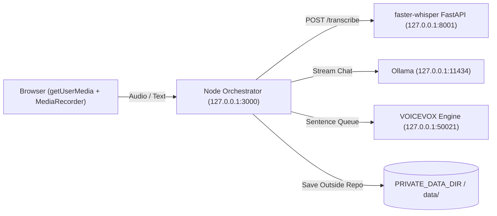

[English](README.md) | [繁體中文](README.zh-TW.md) | [日本語](README.ja.md)

# interview-dojo

A **100% local, zero-API-cost ($0)** AI video mock-interview practice studio designed for **mid-career software engineers, tech leads, and engineering managers / PMs** (currently focused on **Japanese** business & technical interviews).

Everything runs on `127.0.0.1` — your camera recording, microphone audio, resume (`persona.yaml`), transcripts, and evaluation reports **never leave your machine**.

---

## Key Features

- **Push-to-Talk Voice Loop (Low Latency):** Hold button / `Space` to speak → `faster-whisper` (`large-v3-turbo`, CUDA) transcribes Japanese/English mixed tech terms → Ollama (`gemma4:e4b`) streams follow-up questions → `VOICEVOX` synthesizes sentence-by-sentence WAV audio.
- **Local Virtual Interviewer Avatars (3 Switchable Engines + Persistent Memory):**
  - **Mode 1 (SVG):** Lightweight 2D characters (*Suit Shiba Inu*, *Chibi Interviewer*) with Web Audio API lip-sync and auto-blinking.
  - **Mode 2 (3D / VRM):** Three.js + `@pixiv/three-vrm` with built-in 3D characters (*Business-Shirt Interviewer*, *Suit Shiba Inu*) and custom `.vrm` upload, driven by a finite-state machine (`idle / listening / thinking / speaking`).
  - **Mode 3 (Rive):** `@rive-app/canvas` state-machine characters (`avatar-pack.riv`, `teddy.riv`, or custom `.riv` files) served 100% locally.
  - Preferences (engine & character) are automatically saved in `localStorage`.
- **Live Thinking Progress & Audio Replay:** Real-time 3-stage pipeline indicator (`STT → AI Generation (live char count) → TTS`) with elapsed timer, plus one-click `🔊` replay buttons on both the subtitle bar and transcript log.
- **Selectable Interviewer Voices & Speed:** Switch between mature male voices (e.g. 青山龍星, 玄野武宏), professional female voices (e.g. No.7, 九州そら), or casual styles, with adjustable playback speed (`0.85x–1.35x`).
- **Full-Session Video Recording & Timeline Playback:** Records your camera & microphone (`webm`) locally. After finishing, click any timestamp (`[00:12]`) in the transcript to jump directly to that moment in the video.
- **Post-Interview Review & Spoken Japanese Coaching (`gemma4:12b`):**
  - Automatically unloads the live LLM and STT model before loading `gemma4:12b` so **8 GB VRAM** GPUs don't run out of memory.
  - Scores 4 mid-career dimensions: *Conclusion First (結論ファースト)*, *Architecture Trade-offs*, *PM / Stakeholder Alignment*, and *Business Keigo Fluency*.
  - Computes local speech metrics (turn count, character count, Japanese filler-word counts such as `えー / えっと / あの`).
  - Generates a **Spoken Japanese Diagnosis & Read-Aloud Rewrite** section pinpointing awkward phrasing and providing natural, interview-ready Keigo alternatives.
- **One-Click Self-Contained HTML Export:** Export the metrics, AI review, and timestamped transcript into a single offline HTML file (print-friendly for saving as PDF).

---

## Architecture & 8 GB VRAM Budget



| Phase | Active GPU Models | Typical Footprint (8 GB VRAM) |
|---|---|---|
| **Live Interview** | `gemma4:e4b` + `faster-whisper large-v3-turbo (float16)` | ~6.4 GB / 8.0 GB (`VOICEVOX` runs on CPU) |
| **Post-Interview Review** | Unloads `gemma4:e4b` & `STT`, then loads `gemma4:12b` | ~7–8 GB (hybrid GPU/CPU offload as needed) |

---

## Prerequisites

- **OS:** Windows 10/11 (tested) or Linux/macOS (adapt `.ps1` scripts accordingly)
- **Hardware:** NVIDIA GPU with ≥ 8 GB VRAM (tested on RTX 4060 Laptop 8 GB + 32 GB RAM)
- **Runtime:** Node.js `>= 24`, `pnpm`, Python `3.12+`, [Ollama](https://ollama.com/), [VOICEVOX Engine](https://github.com/VOICEVOX/voicevox_engine/releases) (CPU build recommended to save VRAM)

---

## Quick Start

### 1. Install Dependencies & Pull Ollama Models

```bash
git clone https://github.com/YozoraRoy/interview-dojo.git
cd interview-dojo
pnpm install

# Pull live & review models
ollama pull gemma4:e4b
ollama pull gemma4:12b
```

### 2. Set Up the Local STT Service (`faster-whisper`)

```bash
cd services/stt
python -m venv .venv
# Windows PowerShell:
.\.venv\Scripts\python -m pip install -r requirements.txt
cd ../..
```

*(Note: If `ctranslate2` on Windows needs CUDA DLLs, ensure `nvidia-cublas-cu12` and `nvidia-cudnn-cu12` are installed — already included in `requirements.txt`.)*

### 3. Configure Private Data Outside the Repository

**Never place your real resume, recordings, or `.env` inside the git repo.**

```bash
cp .env.example .env
```

Edit `.env` and point `PRIVATE_DATA_DIR` to a folder **outside** this repository (e.g. `D:/private/interview-data`), then optionally copy `examples/persona.sample.yaml` to `<PRIVATE_DATA_DIR>/persona.yaml` and customize your background.

### 4. Start All Services

Start Ollama (`ollama serve`), VOICEVOX Engine (`--host 127.0.0.1 --port 50021`), STT (`services/stt/server.py`), and the Node server, or on Windows run:

```powershell
powershell -ExecutionPolicy Bypass -File scripts/start-all.ps1
```

Open **[http://127.0.0.1:3000](http://127.0.0.1:3000)** in Chrome/Edge, select your preferred interviewer voice, and click **開始面試 (Start Interview)**.

---

## Privacy & Security Design

- **Localhost-Only Binding:** Every service binds exclusively to `127.0.0.1`. No external APIs or telemetry are used.
- **`.gitignore` Guardrails:** `.env*` (except `.env.example`), `data/`, `recordings/`, `transcripts/`, `reports/`, `*.webm`, `*.mp4`, `*.wav`, `*.pdf`, and `models/` are ignored by default.
- **Secret Scanning:** Tested with `gitleaks` pre-commit hook and full-history scan before publishing.

---

## Tests

```bash
node --test server/*.test.ts
```

---

## Credits & Licenses

- **Project Code:** [MIT License](LICENSE)
- **VOICEVOX:** Audio is synthesized locally using [VOICEVOX Engine](https://github.com/VOICEVOX/voicevox_engine). When using or sharing synthesized audio, please credit the character voice per VOICEVOX terms (e.g., `VOICEVOX:青山龍星`, `VOICEVOX:ずんだもん`). The UI footer dynamically displays the active character credit.
- **Models:** Subject to their respective licenses (`Gemma` Terms of Use, `Whisper` MIT).
