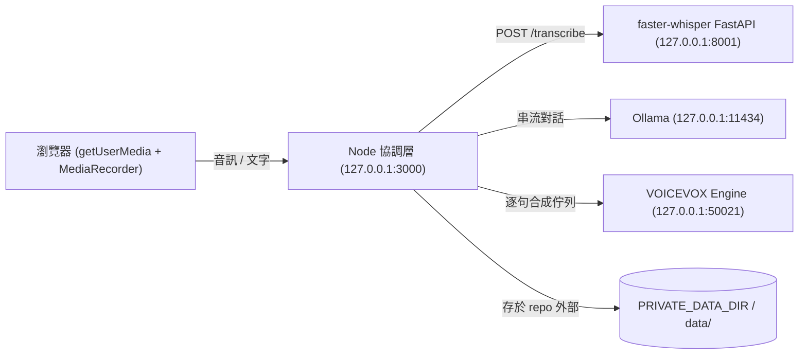

[English](README.md) | [繁體中文](README.zh-TW.md) | [日本語](README.ja.md)

# interview-dojo

**100% 本地運行、零 API 費用（$0）** 的 AI 視訊模擬面試練習工具，專為**中途採用（資深軟體工程師／Tech Lead／架構師／PM）**設計，目前以**日文商務與技術面試**為主。

所有服務皆綁定於 `127.0.0.1`，你的視訊錄影、麥克風音訊、履歷資料（`persona.yaml`）、逐字稿與評分報告**完全不會離開你的電腦**。

---

## 核心功能

- **低延遲按住說話循環：** 按住按鈕或空白鍵說話 → `faster-whisper`（`large-v3-turbo`, CUDA）辨識日英夾雜技術名詞 → Ollama（`gemma4:e4b`）串流追問 → `VOICEVOX` 逐句合成 WAV 語音播放。
- **面試官聲音與語速切換：** 內建多種精選聲線（成熟男聲「青山龍星」、干練男聲「玄野武宏」、專業女聲「No.7」、溫柔女聲「九州そら」、趣味少年音「ずんだもん」等），支援 `0.85x–1.35x` 語速微調。
- **全程錄影與時間軸點擊回放：** 開始面試即同步錄下鏡頭與麥克風（`.webm`）。結束後點擊右側逐字稿的任一時間標記（如 `[00:12]`），影片立即跳轉至該秒數重播。
- **8 GB VRAM 友善的事後復盤與口語診斷（`gemma4:12b`）：**
  - 結束面試時自動卸載即時模型與 STT 模型，再載入 `gemma4:12b`，確保 8 GB 顯卡不爆顯存。
  - 依四大維度評分：**結論先行（結論ファースト）**、**架構與技術取捨（Trade-off）**、**PM／團隊領導協調**、**商務日語自然度與敬語**。
  - 本地程式量化統計回答次數、平均字數、日文填充詞（`えー / えっと / あの` 等）出現次數。
  - 產出**「口語不清診斷與道地日文改寫（朗讀練習專區）」**，直接對照原話與可開口照唸的專業日文說法。
- **一鍵匯出單一 HTML 報告：** 將量化指標、AI 評分與含時間戳記的完整對話紀錄匯出成單一離線 HTML 檔（內建列印樣式，可直接另存 PDF）。

---

## 系統架構與 8 GB VRAM 分配



| 階段 | GPU 上駐留模型 | 約略 VRAM 用量（8 GB 卡） |
|---|---|---|
| **即時面試中** | `gemma4:e4b` ＋ `faster-whisper large-v3-turbo (float16)` | 約 6.4 GB / 8.0 GB（VOICEVOX 跑在 CPU） |
| **面試後復盤** | 先卸載 `gemma4:e4b` 與 STT，再載入 `gemma4:12b` | 約 7–8 GB（必要時自動混合 RAM） |

---

## 環境需求

- **作業系統：** Windows 10/11（已實測）或 Linux/macOS（`.ps1` 腳本需自行對應調整）
- **硬體：** 建議 NVIDIA 8 GB VRAM 以上顯卡（實測於 RTX 4060 Laptop 8 GB + 32 GB RAM）
- **軟體：** Node.js `>= 24`、`pnpm`、Python `3.12+`、[Ollama](https://ollama.com/)、[VOICEVOX Engine](https://github.com/VOICEVOX/voicevox_engine/releases)（建議 CPU 版以節省顯存）

---

## 快速開始

### 1. 安裝依賴與下載 Ollama 模型

```bash
git clone https://github.com/YozoraRoy/interview-dojo.git
cd interview-dojo
pnpm install

ollama pull gemma4:e4b
ollama pull gemma4:12b
```

### 2. 建立本地 STT 語音辨識環境

```bash
cd services/stt
python -m venv .venv
.\.venv\Scripts\python -m pip install -r requirements.txt
cd ../..
```

### 3. 設定外部私人資料夾

**請勿將真實履歷、錄影或 `.env` 放入 git repository。**

```bash
cp .env.example .env
```

編輯 `.env`，將 `PRIVATE_DATA_DIR` 指向 repo **外部** 的資料夾；可參考 `examples/persona.sample.yaml` 在該資料夾建立 `persona.yaml` 填入個人經歷。

### 4. 一鍵啟動全部服務（Windows）

```powershell
powershell -ExecutionPolicy Bypass -File scripts/start-all.ps1
```

用瀏覽器開啟 **[http://127.0.0.1:3000](http://127.0.0.1:3000)**，選擇面試官聲音後點擊「開始面試」即可開始練習。

---

## 資安與隱私設計

- **僅限本機連線：** 所有服務皆只監聽 `127.0.0.1`，無任何雲端呼叫或遙測。
- **`.gitignore` 預設封鎖：** `.env*`（`!.env.example` 除外）、`data/`、`recordings/`、`transcripts/`、`reports/`、`*.webm`、`*.mp4`、`*.wav`、`*.pdf` 與 `models/` 皆預設忽略。
- **機密掃描：** 已配置 `gitleaks` pre-commit hook 並在發佈前完成全歷史掃描。

---

## 測試

```bash
node --test server/*.test.ts
```

---

## 授權與出處標示

- **程式碼授權：** [MIT License](LICENSE)
- **VOICEVOX 出處：** 語音由 [VOICEVOX Engine](https://github.com/VOICEVOX/voicevox_engine) 本地合成。公開或分享音訊時須依官方規範標示角色出處（例如「VOICEVOX:青山龍星」、「VOICEVOX:ずんだもん」），網頁頁尾亦會依所選聲音動態標示。
- **模型授權：** 依各模型原廠條款（`Gemma` Terms of Use、`Whisper` MIT）。
