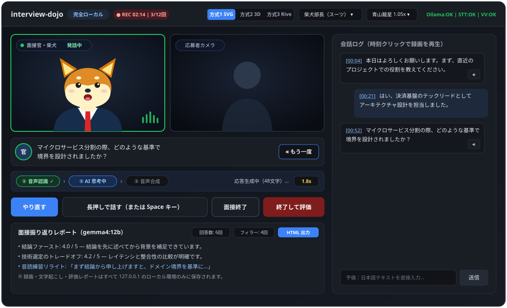

[English](README.md) | [繁體中文](README.zh-TW.md) | [日本語](README.ja.md)

# interview-dojo

專為 **資深軟體工程師、Tech Lead 與工程經理 / PM** 打造的 **本地優先、支援本地／雲端混搭 LLM** 的日文商務與技術模擬面試道場（基於 **Next.js 16.4+ App Router 與 Cache Components**）。

所有服務皆嚴格綁定 `127.0.0.1` —— 鏡頭錄影、麥克風音訊、個人履歷（`persona.yaml`）、逐字稿與 BYOK API Key 皆保留在本機。預設可使用本地 Ollama **零成本（$0）全離線運行**，也可選配外部 LLM API Key，將履歷濃縮與事後深度復盤路由至雲端模型並自動保底降級。



---

## 核心功能

- **Next.js 16.4+ App Router 與 Cache Components：**
  - `/`：即時模擬面試主舞台（Partial Prerendering 靜態外殼＋`<Suspense>` 串流載入）。
  - `/sessions` 與 `/sessions/[id]`：歷史面試列表、支援 HTTP `206 Partial Content` `Range` 時間軸跳轉的錄影回放與復盤報告瀏覽。
  - `/settings`：語音預設、BYOK 外部 API Key 設定與即時連線測試（`POST /api/llm/test`）。
- **本地／雲端三層混搭路由（BYOK 與成本防護）：**
  - 原生 `fetch` 零肥大依賴支援 **Ollama**、**Google Gemini**、**OpenRouter**、**OpenAI**、**Groq** 與 **DeepSeek**。
  - **聰明分工**：即時對話預設走本地 Ollama（或可手動切換雲端 Tier 1）；履歷濃縮（`Tier 2`）與事後復盤（`Tier 3`）優先走雲端以略過 8 GB VRAM 卸載等待。無雲端 Key、斷網或超出 `DAILY_BUDGET_USD`（帳本存於 `data/usage-ledger.json`）時自動無縫退回本地 Ollama。
  - **BYOK 隱私保護**：前端輸入的 Key 僅存於瀏覽器 `localStorage`，透過 Header 傳給本機後端即時轉發，絕不落盤。
- **低延遲語音問答迴圈：** 按住按鈕或 `Space` 說話 → `faster-whisper`（`large-v3-turbo`, CUDA）辨識日英夾雜技術詞彙 → 串流生成回應 → `VOICEVOX` 逐句合成 WAV 並同步驅動虛擬人嘴型。
- **三套虛擬面試官引擎（`next/dynamic` 懶載入）：**
  - **SVG**：輕量 2D 立繪（柴犬部長、Q 版佐藤），支援 Web Audio 口型同步與隨機眨眼。
  - **3D / VRM**：Three.js + `@pixiv/three-vrm`（30 FPS 節流、`low-power`），內建 3D 角色並支援自訂 `.vrm` 匯入。
  - **Rive**：`@rive-app/canvas` 狀態機角色（`avatar-pack.riv`、`teddy.riv` 或自訂 `.riv`）。
- **事後復盤與單一 HTML 匯出：** 四維度評分、日文填充詞（`えー / えっと / あの`）統計、地道敬語朗讀改寫，並可一鍵匯出離線 HTML 報告。

---

## 快速開始

### 1. 安裝依賴與拉取本地模型

```bash
git clone https://github.com/YozoraRoy/interview-dojo.git
cd interview-dojo
pnpm install

# 若需純本地運行，請拉取即時與評分模型
ollama pull gemma4:e4b
ollama pull gemma4:12b
```

### 2. 設定本地 STT 服務（`faster-whisper`）

```bash
cd services/stt
python -m venv .venv
.\.venv\Scripts\python -m pip install -r requirements.txt
cd ../..
```

### 3. 設定環境變數與私人資料夾

```bash
cp .env.example .env
```

編輯 `.env`，將 `PRIVATE_DATA_DIR` 指向 repo 外部資料夾，並視需要填入外部 LLM API Key 與 `DAILY_BUDGET_USD`。

### 4. 一鍵啟動服務

```powershell
# 一鍵啟動 Ollama + STT + VOICEVOX + Next.js（正式模式，未建置會自動 build）
pnpm start:all

# 或開發模式：
pnpm dev:all

# 純雲端 LLM 模式（略過啟動本地 Ollama）：
powershell -ExecutionPolicy Bypass -File scripts/start-all.ps1 -Mode dev -SkipOllama
```

於 Chrome / Edge 開啟 **[http://127.0.0.1:3000](http://127.0.0.1:3000)** 即可開始練習。

---

## 測試與建置

```bash
pnpm test            # node --test "src/lib/**/*.test.ts"
npx tsc --noEmit     # TypeScript 型別檢查
pnpm build           # Next.js 16.4+ Turbopack 建置
```

---

## 📄 授權條款（License）

本專案採用 **Sustainable Use License 1.0 (SUL)**（與 n8n 相同之 fair-code / source-available 授權模式）：

- ✅ **個人、研究與非商業用途**：免費使用，原始碼公開於 GitHub 供學習與個人練習。
- ❌ **商業限制**：未經授權不得將本專案或其衍生作品部署為付費商業服務，或轉售予第三方。
- 🔒 **商業授權**：如有商業使用需求，請開啟 GitHub Issue 或來信聯絡 [service@vestential.com](mailto:service@vestential.com)。

完整條款請參閱 [LICENSE](LICENSE)。
